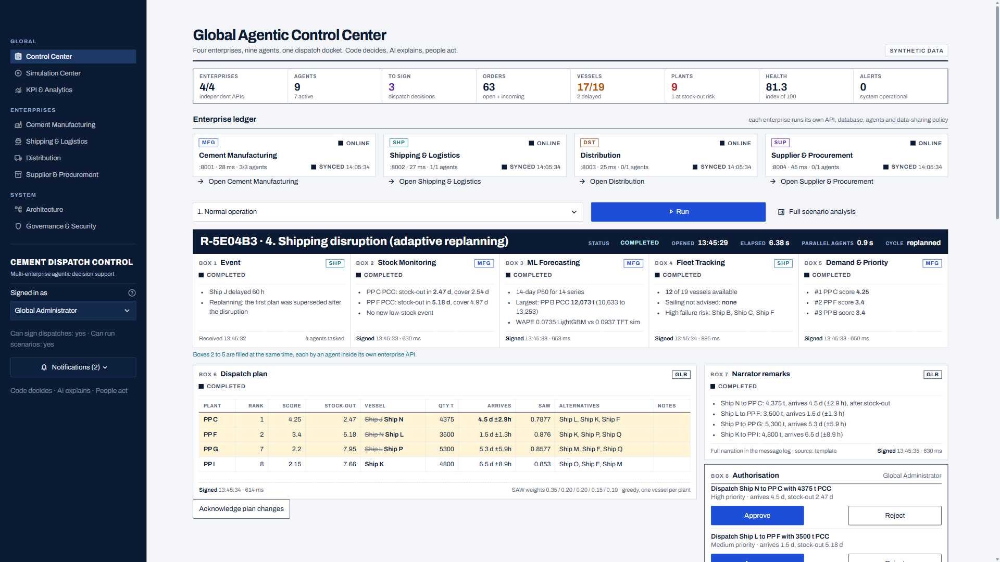
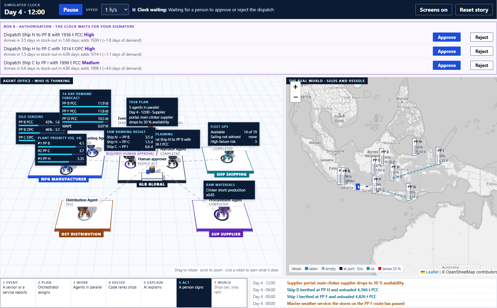
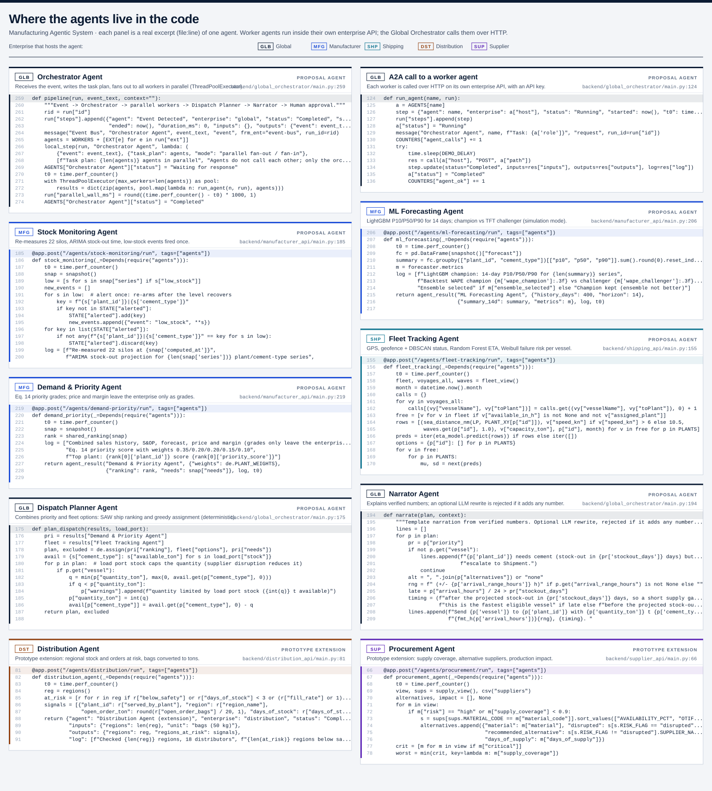

# Manufacturing Agentic System

Prototipe akademik **Global Manufacturing & Cement Supply Chain: Multi-Enterprise Agentic AI Decision Support System** untuk mata kuliah *AI Agentic Technology Systems for Digital Enterprise Ecosystem*.

Sebuah pabrik semen mengirim semen curah dari satu load port ke sembilan packing plant (PP A sampai PP I) dengan 19 kapal milik anak perusahaan pelayaran. Empat enterprise independen (Manufacturer, Shipping, Distribution, Supplier) masing-masing menjalankan API, basis data, agent, dan kebijakan berbagi data sendiri. Global Orchestrator memanggil agent di setiap enterprise secara paralel, Dispatch Planner menyusun rekomendasi kapal, Narrator menjelaskan, dan manusia memberi persetujuan.

> Prinsip utama: **code decides, AI explains, people act.** Seluruh angka berasal dari kode deterministik dan model yang diuji; LLM hanya merangkai fakta yang sudah diverifikasi; keputusan akhir tetap di tangan manusia.

Seluruh data bersifat **sintetis**. Angka performa model menggambarkan kecocokan pada data sintetis, bukan performa model nyata.







## Isi repositori

| Folder | Isi |
|---|---|
| `backend/manufacturer_api/` | Enterprise 1, port 8001. Stock Monitoring, ML Forecasting, Demand & Priority Agent |
| `backend/shipping_api/` | Enterprise 2, port 8002. Fleet Tracking Agent |
| `backend/distribution_api/` | Enterprise 3, port 8003. Distribution Agent (ekstensi prototipe) |
| `backend/supplier_api/` | Enterprise 4, port 8004. Procurement Agent (ekstensi prototipe) |
| `backend/global_orchestrator/` | Port 8000. Orchestrator, Dispatch Planner, Narrator, skenario, approval, KPI |
| `shared/` | Decision engine (SAW, Pers. 14), model ML, keamanan dan RBAC, konektor basis data |
| `data/generate.py` | Generator data sintetis berbasis seed |
| `frontend/` | Dashboard Streamlit (port 3000), termasuk Live Operations 3D (`office3d.html`: three.js dan Leaflet) |
| `scripts/` | Smoke test end-to-end dan pembuat gambar peta kode agent |
| `tests/` | Uji unit decision engine |
| `docs/` | Arsitektur, dokumentasi API, skrip demo, presentasi, riset API publik |
| `.claude/` | Agent dan skill Claude Code yang membantu pengembangan proyek ini |

## Menjalankan

Prasyarat: Python 3.10 atau lebih baru, Docker Desktop (opsional).

```bash
python -m venv .venv
.venv/Scripts/pip install -r requirements.txt      # Windows; di macOS/Linux: .venv/bin/pip
.venv/Scripts/python run_all.py                    # Docker DB + 5 API + Streamlit
```

Buka http://localhost:3000. Perintah `run_all.py` menyalakan PostgreSQL dan MongoDB melalui `docker compose`. Apabila Docker tidak tersedia, sistem otomatis beralih ke penyimpanan lokal (SQLite dan JSON) dengan perilaku yang sama. Mode lokal juga dapat dipilih langsung:

```bash
.venv/Scripts/python run_all.py --no-docker        # tanpa Docker
.venv/Scripts/python run_all.py --no-ui            # hanya API
```

| Layanan | Port | Dokumentasi API |
|---|---|---|
| Global Orchestrator | 8000 | http://localhost:8000/docs |
| Manufacturer API | 8001 | http://localhost:8001/docs |
| Shipping API | 8002 | http://localhost:8002/docs |
| Distribution API | 8003 | http://localhost:8003/docs |
| Supplier API | 8004 | http://localhost:8004/docs |
| Dashboard Streamlit | 3000 | http://localhost:3000 |
| PostgreSQL (Docker) | 5442 | basis data `manufacturer` dan `supplier` |
| MongoDB (Docker) | 27027 | basis data `shipping` |

## Pengujian

```bash
.venv/Scripts/python -m pytest -q tests            # 7 uji unit decision engine
.venv/Scripts/python scripts/smoke_test.py         # 21 pemeriksaan end-to-end (stack harus menyala)
```

Smoke test (21 pemeriksaan) memeriksa kesehatan 4 API, autentikasi 401/403, enam skenario, eksekusi paralel, adaptive replanning, approve dan reject lintas enterprise, dunia langsung (silo terkuras, sensor memicu agent, kapal berangkat dan bongkar, disrupsi alur cerita), perubahan KPI, serta reset.

## Kriteria penerimaan

| Kriteria | Bukti |
|---|---|
| Empat lingkungan enterprise terlihat dan dapat diakses terpisah | Halaman Enterprises, API 8001 sampai 8004 |
| Setiap enterprise memiliki dashboard, API, data lokal, dan agent sendiri | `backend/*_api/`, halaman per enterprise |
| Global Control Center memantau semua enterprise | Halaman Control Center |
| Komunikasi lintas enterprise berjalan | Log pesan antar-agent, log API di Governance |
| Orkestrasi agent dapat dipicu dan berjalan paralel | Simulation Center, `ThreadPoolExecutor` di orchestrator |
| Minimal satu workflow ML prediktif | LightGBM, Random Forest ETA, ARIMA, Weibull, DBSCAN |
| Perhitungan SAW berjalan | `shared/decision_engine.py`, uji unit |
| Alert berbasis event | Notifikasi low stock, sailing not advised, supplier disruption |
| Disrupsi memicu adaptive replanning | Skenario 4, tabel rencana awal vs adaptif |
| Manusia dapat menyetujui atau menolak | Kotak 8 Authorisation pada docket |
| KPI berubah saat simulasi | Halaman KPI & Analytics, smoke test |
| Aplikasi dijalankan dengan perintah terdokumentasi | Bagian "Menjalankan" di atas |

## Dokumentasi lanjutan

- [Laporan proyek](docs/report/Laporan-Manufacturing-Agentic-System.pdf): 46 halaman, disusun berdasarkan materi kuliah Bab 1 sampai 5, termasuk proses agentic coding (DOCX dan PDF).
- [Proses agentic coding](docs/agentic-coding-process.md): cara prototipe ini dibangun bersama coding agent.
- [Arsitektur](docs/architecture.md): representasi E_i, alur agent, model, decision engine, keamanan.
- [Dokumentasi API](docs/api.md): endpoint setiap layanan dan contoh pemanggilan.
- [Skrip demo](docs/demo-script.md): urutan presentasi enam skenario.
- [Panduan pengguna](docs/user-guide.md): cara membaca dashboard.
- [Presentasi](docs/presentation/Manufacturing-Agentic-System.pdf): 16 slide sistem agentic (PPTX dan PDF).
- [Sistem desain](DESIGN.md): gaya visual "Dispatch Manifest".
- [Riset API publik](docs/public-api-research.md): kandidat sumber data nyata untuk integrasi berikutnya.
- [Roadmap](ROADMAP.md): checklist pengerjaan.

## Batasan

- Data sintetis; nama perusahaan, lokasi, dan kapal disamarkan seperti pada proposal.
- Temporal Fusion Transformer tidak dilatih (membutuhkan data historis panjang); challenger ditampilkan dalam mode simulasi.
- Narrator menggunakan template deterministik. LLM aktif apabila `ANTHROPIC_API_KEY` diisi, dan keluarannya ditolak bila memuat angka baru.
- Notifikasi Telegram/WhatsApp disimulasikan di panel notifikasi.
- Distribution dan Supplier merupakan ekstensi prototipe, bukan bagian proposal asli.
- Live Operations 3D membutuhkan browser dengan WebGL; basemap OpenStreetMap dimuat daring, sedangkan plant dan kapal tetap tampil tanpa koneksi. Model robot (RobotExpressive, CC0) dan three.js (MIT) disajikan lokal dari `frontend/static/`.
