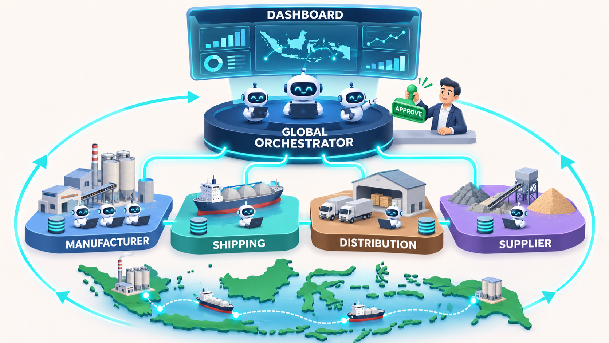
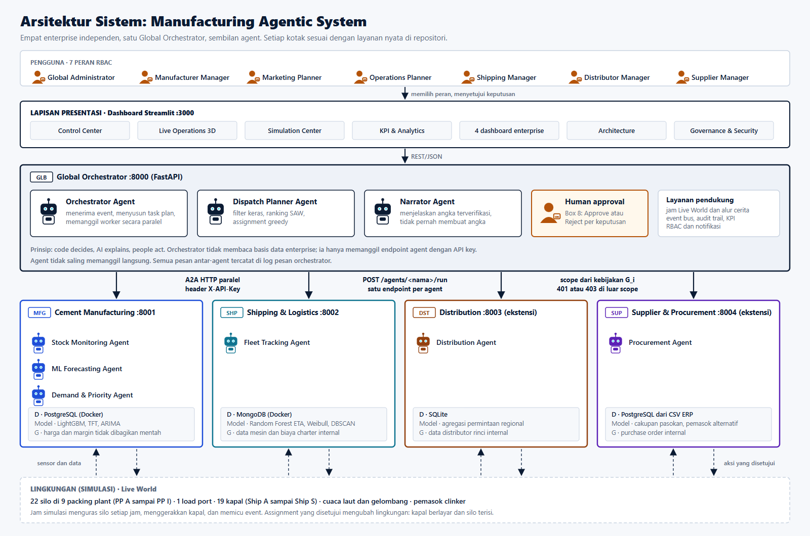
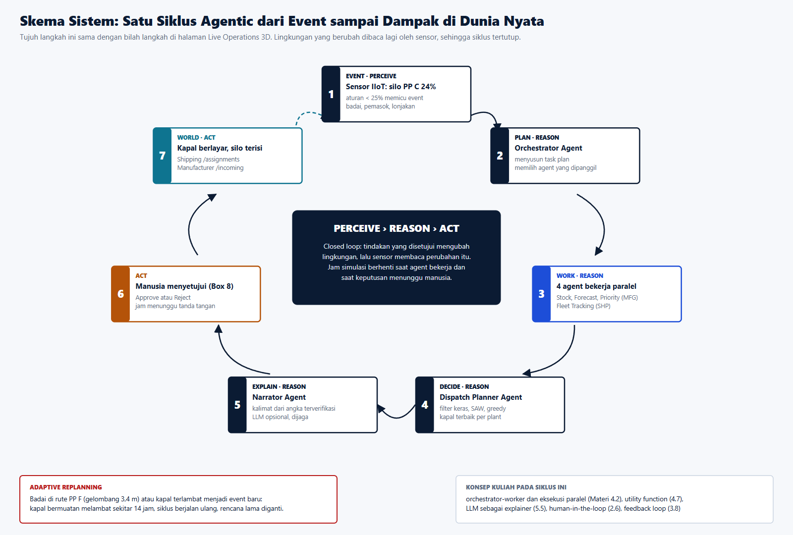
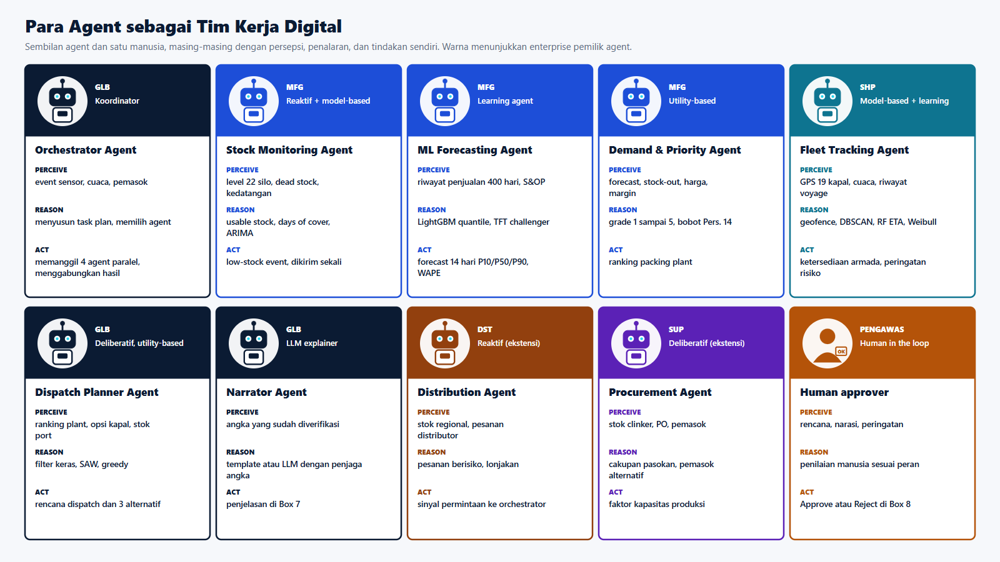
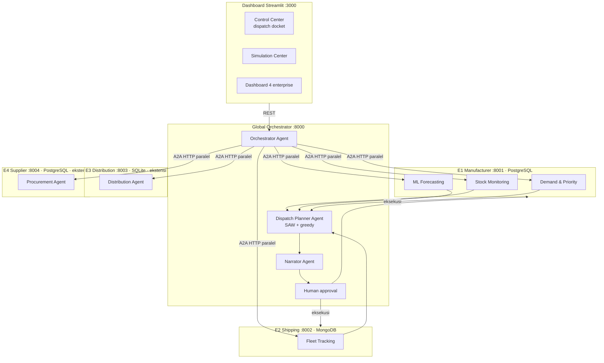

# Arsitektur

Dokumen ini menjelaskan rancangan sistem: representasi setiap enterprise, alur orkestrasi agent, model machine learning, decision engine, integrasi heterogen, serta keamanan dan tata kelola. Sumber acuan utama adalah proposal *Agentic AI Decision Support System for Cement Supply Chain Management* (Bab 4 sampai 8).

## 1. Gambaran sistem

Diagram dibuat oleh `scripts/make_diagrams.py` dari isi kode. Diagram Mermaid berikut merangkum alur yang sama.

Setiap worker agent berjalan di dalam API enterprise pemiliknya. Orchestrator tidak membaca basis data enterprise secara langsung; ia hanya memanggil endpoint agent (`POST /agents/<nama>/run`) dengan API key dan hanya menerima data yang diizinkan kebijakan enterprise tersebut.

## 2. Representasi enterprise E_i = (U_i, M_i, D_i, A_i, P_i, G_i)

| | E1 Manufacturer | E2 Shipping | E3 Distribution | E4 Supplier |
|---|---|---|---|---|
| **U** pengguna | Manufacturer Manager, Marketing Planner, Operations Planner | Shipping Manager | Distributor Manager | Supplier Manager |
| **M** modul | Marketing, Operations, Forecasting, Silo, Packing Plant, Stock-out | Fleet, Tracking, Voyage, ETA, Ranking, Assignment, Maintenance | Inventory, Orders, Demand, Fulfillment | Supplier, Inventory, PO, Performance, Risk |
| **D** data | PostgreSQL: sales_history, sop_plan, packing_plants, silos, silo_level_history, incoming_deliveries, load_port_stock | MongoDB: vessels, voyages, weather, assignments | SQLite: region, distributor, sales_order, regional_demand | PostgreSQL dari ekspor CSV ERP: materials, suppliers, purchase_orders |
| **A** agent | Stock Monitoring, ML Forecasting, Demand & Priority | Fleet Tracking | Distribution Agent | Procurement Agent |
| **P** protokol | REST JSON :8001, snake_case, ton | REST JSON :8002, camelCase bersarang | REST JSON :8003, satuan sak 50 kg | REST JSON :8004, UPPER_SNAKE |
| **G** kebijakan | Harga dan margin tidak dibagikan mentah; orchestrator hanya menerima grade Pers. 14 | Hanya posisi GPS, status, ETA, riwayat voyage yang dibagikan; data mesin dan biaya charter internal | Data distributor rinci internal | Purchase order internal |

Halaman **Architecture** di dashboard menampilkan tabel ini secara langsung, dengan kolom G yang dibaca dari endpoint `/governance` setiap API.

## 3. Alur orkestrasi

1. **Event**: perubahan data (silo di bawah 25%, keterlambatan kapal, gelombang tinggi, gangguan pemasok) atau siklus perencanaan rutin.
2. **Orchestrator Agent** menyusun task plan dan memanggil empat worker secara paralel (`ThreadPoolExecutor`): Stock Monitoring, ML Forecasting, Fleet Tracking, Demand & Priority. Agent ekstensi ikut dipanggil bila skenario membutuhkannya.
3. **Dispatch Planner Agent** menggabungkan hasil sekali: ranking kapal dengan SAW per plant, lalu assignment greedy satu kapal per plant, dibatasi stok load port.
4. **Narrator Agent** menyusun penjelasan dari angka terverifikasi.
5. **Human approval**: keputusan berstatus *Requires human approval*. Persetujuan mengirim assignment ke Shipping API dan jadwal kedatangan ke Manufacturer API; KPI berubah.

Pada **adaptive replanning** (skenario 4), kapal yang direkomendasikan pertama kali diberi keterlambatan 60 jam, lalu seluruh siklus berjalan ulang. Dashboard menampilkan rencana awal dan rencana adaptif berdampingan, dan baris yang berubah tetap disorot sampai pengguna mengonfirmasi.

## 4. Model machine learning

| Kasus | Model | Lokasi | Catatan |
|---|---|---|---|
| Demand forecast 14 hari, P10/P50/P90 | LightGBM quantile (champion) | `shared/ml_models.py` `DemandForecaster` | Backtest WAPE dan coverage P10 sampai P90 |
| Challenger forecast | TFT | idem | **Mode simulasi**: proksi seasonal-naive, bukan TFT terlatih |
| Ship arrival time | Random Forest regression | `EtaModel` | 282 voyage, rentang dari sebaran antar-pohon (Pers. 7) |
| Silo stock-out time | ARIMA(1,0,0) | `arima_stockout_days` | Dirata-rata dengan P50 dan memperhitungkan kedatangan terjadwal (Pers. 9 sampai 10) |
| Predictive maintenance | Weibull survival (AFT) | `WeibullMaintenance` | Risiko kerusakan 14 hari dari 199 equipment delay |
| Status kapal | Geofence (proposal) + DBSCAN (persyaratan tugas) | `geofence_status`, `dbscan_status` | Sailing, anchored, berthed |

Seluruh model dilatih pada data sintetis saat API dinyalakan.

## 5. Decision engine

Implementasi: `shared/decision_engine.py`, diuji di `tests/test_decision_engine.py`.

- **Usable stock dan days of cover** (Pers. 1 sampai 2): `Usable = Σ max(0, L·Cap − DS)`, `DoC = Usable / rata-rata P50 14 hari`.
- **Prioritas packing plant** (Pers. 14): setiap kriteria diberi grade 1 sampai 5 dari batas b(i,1..4); bobot stock-out days 0,35, endurance 0,20, selling price 0,20, forecast demand 0,15, contribution margin 0,10.
- **Ranking kapal SAW** (Pers. 15 sampai 16): benefit `x/max`, cost `min/x`; bobot arrival time 0,35, capacity 0,20, proven calls 0,20, evidence 0,15, weather 0,10. Kriteria tanpa data dikeluarkan dan bobot diskalakan ulang.
- **Filter keras**: kapal maintenance, kapal yang sudah berkomitmen, jenis semen tidak sesuai, dan gelombang di atas 2,5 m (*sailing not advised*) dikeluarkan. Risiko Weibull di atas 30% diberi peringatan.
- **Assignment** (Pers. 17 sampai 18): plant diproses dari skor tertinggi, masing-masing mengambil kapal terbaik yang masih bebas, maksimal tiga alternatif disimpan.

## 6. Integrasi heterogen

Pilihan teknologi berbeda per enterprise untuk menunjukkan heterogenitas. Pilihan ini merupakan rancangan prototipe, bukan sistem nyata organisasi mana pun.

| Enterprise | Basis data | Bentuk data | Satuan |
|---|---|---|---|
| Manufacturer | PostgreSQL (Docker) via SQLAlchemy | relasional, snake_case | ton |
| Shipping | MongoDB (Docker) via PyMongo | dokumen bersarang, camelCase | ton, knot, jam |
| Distribution | SQLite, SQL mentah | relasional, snake_case | sak 50 kg |
| Supplier | PostgreSQL (Docker), dimuat dari CSV ERP | tabel datar, UPPER_SNAKE | sesuai material |

Orchestrator menormalkan satuan (misalnya 20 sak = 1 ton). Setiap panggilan lintas enterprise melewati satu fungsi `call()` yang menambahkan API key, mencoba ulang sekali pada kegagalan jaringan, mencatat log keluar, dan memperbarui status sinkronisasi.

## 7. Keamanan dan tata kelola

| Guardrail | Penerapan |
|---|---|
| Autentikasi | Header `X-API-Key` (simulasi); 401 bila tidak valid |
| Otorisasi per enterprise | Scope dari kebijakan G_i; 403 bila di luar scope |
| RBAC tampilan | Tujuh peran di `shared/rbac.py`; halaman dan tab disaring per peran |
| Angka deterministik | Skor, ETA, dan ranking dari kode dan model; LLM tidak menghitung |
| Narasi terbatas | Keluaran LLM ditolak bila memuat angka yang tidak ada di fakta |
| Fail-safe | Bila LLM gagal, rencana tetap terkirim dengan narasi template |
| Alert once | Low-stock event dikirim sekali dan aktif kembali setelah pulih |
| Human in the loop | Hanya Global Administrator, Manufacturer Manager, dan Shipping Manager yang dapat menyetujui |
| Audit trail | Run skenario, persetujuan, penolakan, upaya yang ditolak, dan reset tercatat |

## 8. Dunia langsung (live world)

Jam simulasi di orchestrator menggerakkan lingkungan fisik setiap detik:

| Langkah | Enterprise | Endpoint |
|---|---|---|
| Kapal bergerak dalam siklus muat, berlayar bermuatan, bongkar, kembali kosong, antre | Shipping | `POST /world/tick` |
| Muatan dibongkar dan silo terisi sesuai ruang kosong | Manufacturer | `POST /world/deliver` |
| Silo terkuras sesuai permintaan harian setiap plant | Manufacturer | `POST /world/tick` |
| Deteksi event (silo di bawah 25%) dan alur cerita disrupsi | Global Orchestrator | `GET /world`, `POST /world/play`, `/world/pause`, `/world/speed` |

Jam berhenti selama agent bekerja dan selama keputusan menunggu persetujuan, sehingga lingkungan hanya berubah setelah manusia bertindak. Siklus ini menutup loop perceive, reason, act: tindakan yang disetujui mengubah lingkungan, dan pembacaan sensor berikutnya mencerminkan perubahan itu. Waktu pelabuhan (muat 12 jam, antre 6 jam, bongkar 18 jam) dan perlambatan akibat badai (14 jam) merupakan asumsi prototipe.

## 9. Komponen dari proposal dan tambahan prototipe

| Komponen | Sumber |
|---|---|
| Tujuh agent inti, pola orchestrator-worker, eksekusi paralel | Proposal |
| LightGBM, TFT challenger, Random Forest ETA, ARIMA, Weibull, geofence | Proposal (TFT dalam mode simulasi) |
| Pers. 14, SAW, greedy assignment, bobot 0,35/0,20/0,20/0,15/0,10 | Proposal |
| Enterprise Distribution dan Supplier, beserta agent-nya | Ekstensi prototipe akademik |
| DBSCAN untuk aktivitas kapal | Persyaratan tugas, ditambahkan di samping geofence |
| Seluruh dataset | Sintetis |
